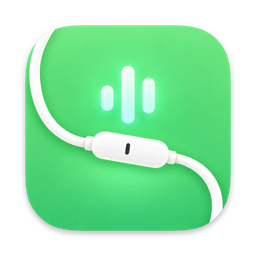

<p align="center">
  
</p>

<h1 align="center">Dimmela</h1>

<p align="center"><a href="https://dimmela.app">dimmela.app</a> · <a href="https://github.com/mameli/Dimmela/releases/latest"><b>Download the latest version</b></a> · macOS 15+ · Apple Silicon</p>

A native macOS menu-bar app for dictation. Hold or tap `fn+Space`, speak, and Dimmela pastes the text where you are typing. Speech is transcribed on your Mac by Parakeet v3 on the Neural Engine. Optionally, an LLM rewrites each Dictation with your own prompts and skills.

It is a lighter alternative to [Handy](https://handy.computer): with the speech model loaded the app uses about 60 MB of memory, against Handy's 900 MB (the model's weights live with the Neural Engine and are not counted there; even counting them it stays well under half).

```sh
brew install --cask mameli/dimmela/dimmela
```

Or download `Dimmela.zip` from the [latest release](https://github.com/mameli/Dimmela/releases/latest), open it and move Dimmela to Applications.

## How it works

- **Dictation**: hold `fn+Space` and release when you are done (Hold), or tap it to dictate hands-free until the next tap (Lock). `Esc` cancels.
- **Modes**: folders of prompt files or skills (`SKILL.md`) become Modes. Every Dictation starts with the Default Mode; while dictating, `1`–`9` pick another one and `shift` shows the list. Post-processing goes to any OpenAI-compatible provider, such as OpenRouter.
- **Vocabulary**: names and terms that speech recognition gets wrong are fixed in the Transcript and given to the LLM.
- **History**: the last five Dictations, with their audio, to copy or Post-process again from the menu.

The words Dimmela uses are defined in [CONTEXT.md](CONTEXT.md), its decisions in [docs/adr](docs/adr).

## Building

```sh
cp Config/Local.xcconfig.example Config/Local.xcconfig
xcodebuild -project Dimmela.xcodeproj -scheme Dimmela -configuration Debug -derivedDataPath build/DerivedData build
```

Domain tests: `cd DimmelaCore && swift test`. What needs a Mac is checked by hand with [docs/TESTING.md](docs/TESTING.md).

## License

MIT
